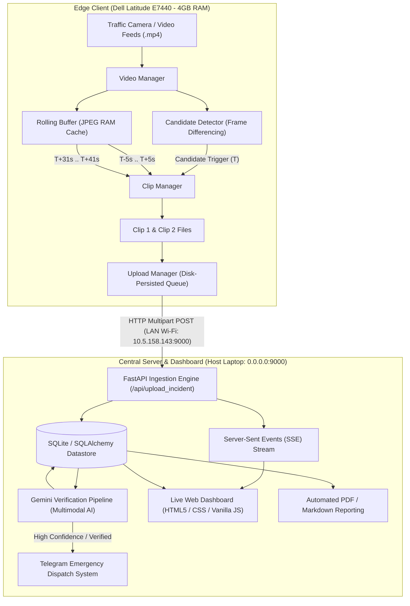
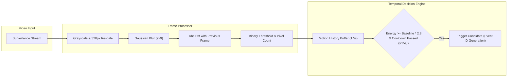
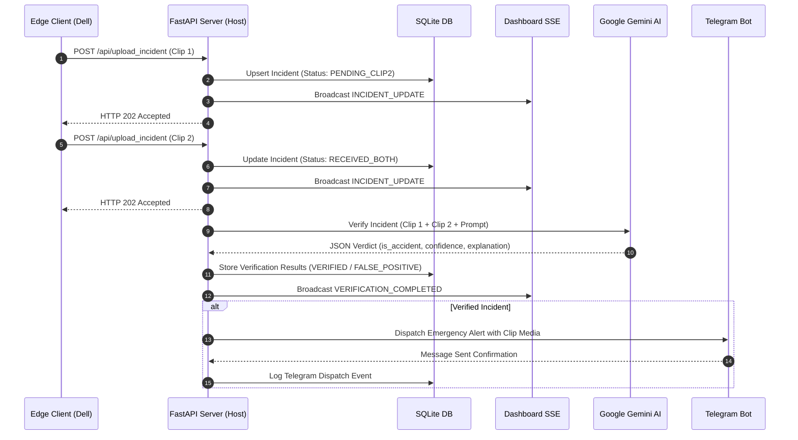
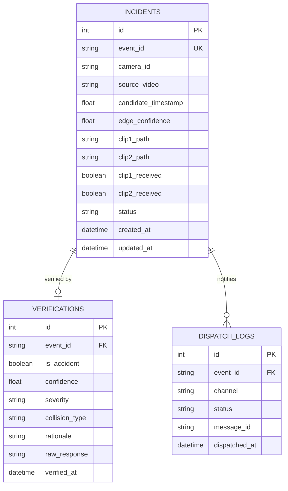
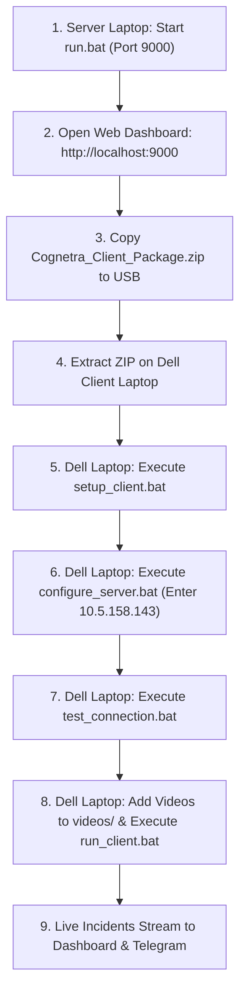

# Cognetra 3.0 — Comprehensive System Architecture & Engineering Report

---

## 1. Executive Summary

**Cognetra** is an end-to-end, privacy-preserving, edge-to-cloud distributed accident detection and emergency dispatch platform. The system operates across a dual-node topology:
1. **Edge Client Node**: Lightweight, low-power surveillance computer (Dell Latitude E7440, Windows 10, 4 GB RAM, CPU-only) that monitors continuous video feeds, executes real-time motion anomaly detection, cuts synchronized two-clip evidence packets, and uploads them to the central server via a persistent disk queue.
2. **Central Server & Backend Node**: Windows/Linux-compatible FastAPI backend (`0.0.0.0:9000`) paired with an SQLite/SQLAlchemy persistent datastore, Google Gemini multimodal AI visual verification pipeline, Telegram bot emergency notification dispatch system, Server-Sent Events (SSE) real-time streaming engine, and an interactive operational dashboard.



---

## 2. Distributed System Topology & Networking

| Attribute | Server Laptop (Node A) | Edge Client Laptop (Node B - Dell) |
| :--- | :--- | :--- |
| **Operating System** | Windows 10 / 11 64-bit | Windows 10 64-bit (Latitude E7440) |
| **Compute Constraints** | Host CPU / Standard GPU | Intel Core i5 (4th Gen), 4 GB RAM, No GPU |
| **IP Address** | `10.5.158.143` (Wi-Fi) | Dynamic LAN IP (Same Subnet) |
| **Listening Port** | `0.0.0.0:9000` (TCP Inbound Allowed) | Outbound only (no listening ports) |
| **Core Runtime** | Python 3.12 + FastAPI + Uvicorn | Python 3.12 + OpenCV Headless + Requests |
| **Storage Role** | Master DB (`cognetra.db`), Clips, Reports | Temporary rolling cache & disk queue (`queue/`) |

### Windows Firewall Configuration
TCP Port 9000 inbound traffic is permitted on the Server Node via Windows Defender Firewall:
- **Rule Name**: `Cognetra Server Port 9000`
- **Protocol**: TCP
- **Local Port**: 9000
- **Action**: Allow Inbound Connection

---

## 3. Edge Client Architecture

The Edge Client is designed to operate on memory-constrained hardware (4 GB RAM, no GPU) without deep learning model overhead.



### 3.1 Video Management & Streaming (`video_manager.py`)
- Discovers and parses supported formats: `.mp4`, `.avi`, `.mov`, `.mkv`, `.webm`.
- Implements sequential iteration with automatic looping (`loop_videos: true`) to simulate uninterrupted 24/7 CCTV ingestion.
- Recovers gracefully from corrupt or truncated video files without terminating background loops.

### 3.2 Candidate Detection Engine (`candidate_detector.py`)
- **Lightweight CPU Processing**: Frames are downscaled to 320px width and converted to single-channel 8-bit grayscale.
- **Background Filtering**: A 9x9 Gaussian blur eliminates high-frequency noise and compression artifacts.
- **Anomaly Heuristic**: Absolute frame differencing computes the percentage of active pixels (`motion_energy`). When `motion_energy` surges past $2.8\times$ the running dynamic baseline (derived from the preceding 1.5 seconds) and exceeds a 3.5% area threshold, a candidate is triggered.
- **Cooldown Throttling**: A 15-second refractory cooldown suppresses secondary triggers for the same continuous collision.
- **Identifier Specification**: Unique event IDs are generated strictly obeying the server schema:
  $$\text{Format: } \text{EVT-YYYYMMDD-HHMMSS-XXXXXX}$$
  *(Regex: `^[A-Za-z0-9_\-]+$`, maximum 64 characters).*

### 3.3 Rolling Buffer & Evidence Packaging (`clip_manager.py`)
- **Ultra-low RAM JPEG Buffer**: Frames are cached in-memory as compressed JPEG byte arrays rather than raw numpy arrays, keeping memory utilization under 15 MB.
- **Dual-Clip Evidence Strategy**:
  - **Clip 1 (Impact Interval)**: Spans $[T - 5.0\text{s}, T + 5.0\text{s}]$, capturing the immediate approach, collision, and initial post-impact state.
  - **Clip 2 (Post-Impact Status)**: Spans $[T + 31.0\text{s}, T + 41.0\text{s}]$, capturing vehicle posture, traffic obstruction, occupant egress, and fire or secondary hazard emergence.
- Automatic source video boundary protection ensures clips do not overrun file boundaries.

### 3.4 Upload Manager & Failover Queue (`upload_manager.py`)
- **Disk-Backed Queue**: Every cut clip is paired with metadata and committed as an atomic JSON record to `queue/{event_id}_clip{number}.json`.
- **Deduplication**: In-flight IDs are indexed to avoid duplicate uploads.
- **Worker Thread**: A non-blocking background daemon reads queue records, handles exponential retry delays, validates HTTP 202 server receipts, and unlinks disk entries only upon server acknowledgment.

---

## 4. Server & Backend Architecture

The backend is built with FastAPI and SQLAlchemy, serving as the central coordinator, database custodian, and verification engine.



### 4.1 REST API Contract

#### `GET /health`
Returns server heartbeat:
```json
{
  "status": "ok",
  "server": "cognetra",
  "host": "0.0.0.0",
  "port": 9000
}
```

#### `GET /api/status`
Reports subsystem telemetry:
- Database connectivity (`OK` / `ERROR`)
- Google Gemini API state (`CONFIGURED` / `NOT CONFIGURED`)
- Telegram alert gateway (`CONFIGURED` / `NOT CONFIGURED`)
- Queued / active verifications count
- Active incidents tally

#### `POST /api/upload_incident`
Accepts `multipart/form-data`:
- `clip`: Video binary (`.mp4`, `.mov`, `.avi`, `.mkv`)
- `event_id`: Unique string ID
- `clip_number`: Integer (`1` or `2`)
- `camera_id`, `source_video`, `candidate_timestamp`, `edge_confidence`, `speed`, `vehicle_type`
- **Response**: HTTP 202 Accepted (`{"status": "accepted", "incident_status": "..."}`)

#### `GET /api/events`
Text/event-stream connection delivering real-time reactive UI updates to the dashboard via Server-Sent Events.

### 4.2 Relational Data Model (`models/database.py`)



### 4.3 Google Gemini AI Multimodal Verification (`verifier/gemini_verifier.py`)
- Analyzes both Clip 1 (impact dynamics) and Clip 2 (aftermath status) alongside telemetry parameters.
- Prompts Gemini with structured JSON output requirements:
  - Accident classification (`true`/`false`)
  - Confidence rating ($0.0 - 1.0$)
  - Roadway condition & vehicle classifications
  - Severity level (`MINOR`, `MODERATE`, `CRITICAL`)
  - Obstruction assessment
- **Edge Confidence Bypass**: If edge confidence $\ge 0.95$, emergency dispatch executes immediately while AI analysis confirms post-impact status concurrently.

### 4.4 Telegram Emergency Notification Gateway (`services/telegram_service.py`)
- Assembles emergency dispatch payloads:
  - Event ID & Camera Identifier
  - Collision Classification & Severity
  - Direct video preview link / thumbnail attachment
  - Interactive verification status badge
- Implements exponential retry backoff and rate-limiting safety guards.

---

## 5. Web Dashboard & Operator Interface

The dashboard (`dashboard/index.html`, `style.css`, `app.js`) is implemented with modern vanilla Web technologies:
- **Zero-Dependency Architecture**: Runs without Node.js, Webpack, or external JS runtime dependencies.
- **Reactive SSE Connection**: Connects to `/api/events` to ingest incident updates with zero polling overhead.
- **Dual-Clip Video Player**: Synchronous side-by-side or tabbed inspection of Clip 1 and Clip 2.
- **Real-Time Telemetry Cards**: Visual gauges for Server Status, Gemini API status, Database Health, and Edge Nodes.
- **Incident Audit Trail**: Filterable event table with status chips (`PENDING_CLIP2`, `VERIFYING`, `VERIFIED_ACCIDENT`, `FALSE_POSITIVE`).

---

## 6. Verification & Test Suite Summary

The system is validated through extensive automated test suites across both server and client domains.

### Server Test Suite (`tests/`)
- **Total Tests**: 28
- **Pass Rate**: 100% (28 passed)
- **Coverage**: Database initialization, multipart upload parsing, clip association, status transitions, SSE event broadcast, reporting generation, health telemetry.

### Client Test Suite (`Cognetra_Client/tests/`)
- **Total Tests**: 58
- **Pass Rate**: 100% (58 passed in 0.74s)
- **Coverage**:
  - `test_config.py` (9 tests): Schema validation, IP updating, config persistence.
  - `test_connection.py` (9 tests): Health probing, error handling, timeout recovery.
  - `test_video_manager.py` (6 tests): Format filtering, sequence loop, file resilience.
  - `test_detector.py` (7 tests): Thresholding, cooldown suppression, event ID regex compliance.
  - `test_clip_manager.py` (6 tests): Buffer slicing, dual clip window calculations, task retention.
  - `test_upload_manager.py` (11 tests): Disk queue persistence, retry escalation, item deduplication.
  - `test_compatibility.py` (10 tests): Strict validation against the server REST contract.

---

## 7. Deployment & Operational Runbook



### Server Laptop Setup
1. Open Command Prompt in project directory:
   ```bat
   run.bat
   ```
2. Verify in browser: `http://localhost:9000/health`
3. Keep dashboard active: `http://localhost:9000`

### Client Laptop (Dell Latitude E7440) Setup
1. Extract `Cognetra_Client_Package.zip` to `C:\Cognetra_Client`.
2. Run installation script:
   ```bat
   setup_client.bat
   ```
3. Configure target server IP:
   ```bat
   configure_server.bat
   REM Enter: 10.5.158.143
   ```
4. Verify LAN link:
   ```bat
   test_connection.bat
   ```
5. Place target surveillance recordings in `videos\` and launch monitoring:
   ```bat
   run_client.bat
   ```

---

## 8. Repository File Structure

```text
cognetra 3.0/
├── app.py                           # FastAPI core entrypoint
├── requirements.txt                 # Backend Python dependencies
├── run.bat                          # Server startup script
├── build_client_package.py          # Standalone client packaging tool
├── Cognetra_Client_Package.zip      # Production-ready client distribution archive
│
├── config/
│   └── settings.py                  # Pydantic server settings & env loaders
│
├── api/
│   ├── upload.py                    # Multipart clip upload router
│   ├── dashboard.py                 # REST telemetry & incident status endpoints
│   └── events.py                    # Server-Sent Events (SSE) router
│
├── services/
│   ├── incident_service.py          # State machine & clip pairing logic
│   ├── verification_service.py      # Gemini job queue coordinator
│   ├── telegram_service.py          # Alert dispatcher & bot integration
│   ├── database_service.py          # SQLAlchemy persistence wrapper
│   └── reporting_service.py         # Markdown/PDF digest generator
│
├── models/
│   └── database.py                  # SQLAlchemy schema definitions
│
├── verifier/
│   └── gemini_verifier.py           # Google Gemini multimodal prompt engine
│
├── dashboard/
│   ├── index.html                   # Central operations UI
│   ├── style.css                    # Responsive dark dashboard styling
│   └── app.js                       # Real-time SSE listener & UI bindings
│
├── data/
│   └── cognetra.db                  # SQLite persistent database
│
├── Cognetra_Client/                 # Edge Client Core
│   ├── main.py                      # Client CLI runner & banner
│   ├── client.py                    # Central Edge coordinator loop
│   ├── config.py                    # Client dataclass configuration
│   ├── config.json                  # Dynamic runtime configuration
│   ├── video_manager.py             # Video decoding & playback loop
│   ├── candidate_detector.py        # Frame differencing anomaly detector
│   ├── clip_manager.py              # Rolling buffer & two-clip cutter
│   ├── upload_manager.py            # Disk queue & multipart uploader
│   ├── server_connection.py         # Network health probe
│   ├── heartbeat.py                 # Keep-alive monitor
│   ├── logger.py                    # Rotating multi-channel logger
│   ├── setup_client.bat             # Automated Windows venv installer
│   ├── configure_server.bat         # Interactive server IP config script
│   ├── test_connection.bat          # Network test runner
│   ├── run_client.bat               # Client launch script
│   ├── README_CLIENT.md             # Client operator guide
│   ├── SERVER_COMPATIBILITY.md      # API contract documentation
│   ├── CHECKPOINTS.md               # Quality assurance verification ledger
│   └── videos/                      # Input video directory
│       └── sample_traffic_feed.mp4  # Built-in synthetic test video
│
└── tests/                           # Server automated test suite
```
