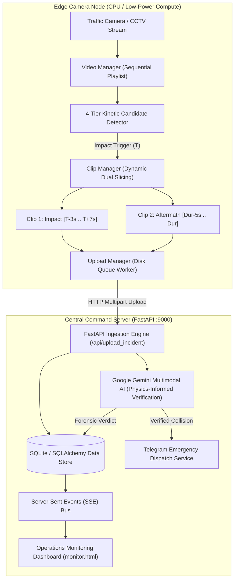

# COGNETRA 3.0 (IRIS) — Zero-Shot Traffic Accident Detection & Emergency Dispatch

[](https://www.python.org/)
[](https://fastapi.tiangolo.com/)
[](https://ai.google.dev/)
[](https://core.telegram.org/bots/api)
[](LICENSE)

> **Autonomous Edge-to-Cloud Distributed Traffic Accident Verification, Forensic Assessment & Real-Time Emergency Dispatch Platform**

---

## 📌 Overview

**COGNETRA 3.0 (IRIS)** addresses the critical **"Golden Hour"** in traffic emergency response. Conventional CCTV surveillance systems either rely on human operators (introducing a 15–30 minute dispatch latency) or stream high-definition video 24/7 to central servers, consuming massive network bandwidth and triggering high false-alarm rates.

COGNETRA resolves these bottlenecks via a **decoupled edge-cloud architecture**:
- **Edge Client Node:** Performs local motion anomaly and kinetic tracking at 30+ FPS using lightweight morphological frame differencing, ByteTrack velocity estimation, and geometric Time-to-Collision (TTC) projection. Zero raw 24/7 video streaming.
- **Dynamic Dual-Clip Slicing:** When a kinetic anomaly fires at timestamp $T$, the edge node surgically extracts two 10-second evidentiary bitstreams:
  - **Clip 1 (Impact Window):** Dynamically sliced from $[T-3\text{s} \dots T+7\text{s}]$ to capture the vehicle approach, physical collision, and immediate deformation.
  - **Clip 2 (Aftermath Window):** Extracted from $[\text{Duration}-5\text{s} \dots \text{Duration}]$ to capture vehicle final resting states, debris fields, and road blockage.
- **Central Server & Multimodal AI:** Upon clip upload, the server queries **Google Gemini Vision-Language Model** with a physics-informed collision prompt (enforcing momentum dynamics $p = m \cdot v$ for heavy vehicles, entrapment risk triage, and collision classification).
- **Sub-5s Emergency Dispatch:** Verified accidents trigger real-time alerts via an interactive **Telegram Bot** and push live updates to the reactive **Operations Dashboard** via Server-Sent Events (SSE).

---

## 🏗️ System Architecture



---

## ⚡ Core Features

- **Bandwidth Conservation:** Cameras stream zero 24/7 video; data transmission occurs exclusively during detected incident windows (~10MB per event).
- **4-Tier Edge Candidate Detector:**
  1. *Bounding Box Overlap:* Physical intersection of tracked vehicle blobs.
  2. *Adaptive Kinetic Energy:* 3-tier dynamic energy spike detection relative to moving baselines.
  3. *Geometric TTC Projection:* Closest Point of Approach (CPA) vector calculation ($TTC \le 1.5\text{s}$).
  4. *Panic Braking:* Rapid deceleration detection ($>75\%$ speed drop to standstill in $<0.45\text{s}$).
- **Physics-Informed Forensic Verification:**
  - Enforces heavy commercial vehicle momentum principles ($p = m \cdot v$) to prevent false "near-miss" classifications on large trucks, buses, and semi-trailers.
  - Generates structural damage, cabin intrusion, and entrapment risk evaluations.
- **Fail-Open Emergency Policy:** If cloud API or network connectivity is disrupted, high-confidence edge triggers automatically promote for dispatch to ensure life safety.
- **Operations Dashboard:** Real-time web console with synchronized dual-clip browser players, live SSE telemetry, incident breakdown charts, and one-click database reset.

---

## 📂 Repository Structure

```
Zero-Shot-Learning-Cognetra/
│
├── central_server/                      # Central Backend & AI Engine
│   ├── api/                             # FastAPI route handlers
│   │   ├── upload.py                    # Dual-clip ingestion endpoint
│   │   ├── dashboard.py                 # Telemetry & REST query endpoints
│   │   └── events.py                    # Server-Sent Events (SSE) pub/sub
│   ├── config/                          # Central server configuration
│   │   └── settings.py                  # Pydantic environment loader
│   ├── dashboard/                       # Operations Monitor Web Console
│   │   ├── monitor.html                 # Reactive dual-clip monitoring console
│   │   ├── index.html                   # Alternative dashboard view
│   │   ├── app.js                       # Dashboard JS helpers
│   │   └── style.css                    # Dashboard stylesheet
│   ├── models/                          # Datastore schema
│   │   └── database.py                  # SQLAlchemy models (Incidents, Verifications)
│   ├── services/                        # Business logic & integrations
│   │   ├── incident_service.py          # State machine orchestrator
│   │   ├── telegram_service.py          # Telegram bot dispatch alerts
│   │   └── event_bus.py                 # SSE event broadcaster
│   ├── verifier/                        # Multimodal VLM engine
│   │   └── gemini_verifier.py           # Gemini 1.5/3.5 Flash forensic verifier
│   ├── app.py                           # Server entrypoint
│   ├── requirements.txt                 # Backend dependencies
│   └── .env.example                     # Environment template
│
├── edge_client/                         # Edge Camera Compute Node
│   ├── candidate_detector.py            # 4-tier kinetic tracking engine
│   ├── clip_manager.py                  # Dynamic time-of-crash dual slicer
│   ├── upload_manager.py                # Disk-persisted upload queue
│   ├── video_manager.py                 # Sequential playlist orchestrator
│   ├── server_connection.py             # Server health probe
│   ├── config.py & config.json          # Edge detection thresholds & settings
│   ├── main.py                          # Edge client entrypoint
│   ├── requirements.txt                 # Edge client dependencies
│   └── videos/                          # Benchmark dataset videos (10 scenarios)
│
├── ARCHITECTURE.md                      # Comprehensive mathematical & engineering specification
├── PRESENTATION_SCRIPT.md               # Word-for-word screen recording & defense script
├── reset_system.py                      # One-click telemetry purge & reset tool
├── check_verdicts.py                    # Incident verdict audit utility
├── check_nearmiss.py                    # Near-miss analysis inspector
├── start_all.bat & start_all.ps1        # Automated dual-node launcher
└── README.md                            # Project documentation
```

---

## 🚀 Quickstart Guide

### 1. Prerequisites
- **Python 3.10+** (Tested on Python 3.11 / 3.12)
- **FFmpeg** (installed and in system PATH, or installed via `imageio-ffmpeg`)
- Google Gemini API Key ([Google AI Studio](https://aistudio.google.com/app/apikey))
- Telegram Bot Token & Chat ID ([BotFather](https://t.me/BotFather))

---

### 2. Central Server Setup

1. Open a terminal in `central_server/`:
   ```bash
   cd central_server
   python -m venv .venv
   ```
   - Windows: `.venv\Scripts\activate`
   - Linux/macOS: `source .venv/bin/activate`

2. Install dependencies:
   ```bash
   pip install -r requirements.txt
   ```

3. Configure environment variables:
   ```bash
   cp .env.example .env
   ```
   Edit `.env` with your API credentials:
   ```env
   GEMINI_API_KEY=your_gemini_api_key_here
   TELEGRAM_BOT_TOKEN=your_telegram_bot_token_here
   TELEGRAM_CHAT_ID=your_telegram_chat_id_here
   HOST=127.0.0.1
   PORT=9000
   ```

4. Launch the Central Server:
   ```bash
   uvicorn app:app --host 127.0.0.1 --port 9000
   ```
   - Operations Dashboard: **`http://127.0.0.1:9000/monitor`**
   - OpenAPI Documentation: **`http://127.0.0.1:9000/docs`**

---

### 3. Edge Client Setup

1. Open a second terminal in `edge_client/`:
   ```bash
   cd edge_client
   python -m venv .venv
   ```
   - Windows: `.venv\Scripts\activate`
   - Linux/macOS: `source .venv/bin/activate`

2. Install dependencies:
   ```bash
   pip install -r requirements.txt
   ```

3. Run the Sequential Playlist Processor:
   ```bash
   python main.py
   ```
   The edge client will probe the server, process the 10 benchmark videos sequentially, detect collisions, extract dual clips, and upload them to the server queue.

---

## 📊 Benchmark Dataset Results

Evaluated across 10 diverse CCTV traffic accident and near-miss scenarios:

| Video ID | Scenario Type | Edge Trigger | Crash Time ($T$) | VLM Forensic Verdict | Severity | Confidence |
|:---:|:---|:---:|:---:|:---:|:---:|:---:|
| **V01** | High-Speed Impact | `MOTION_TRIGGER` | $T = 2.2\text{s}$ | ✅ `VERIFIED_ACCIDENT` | `MODERATE` | 95% |
| **V02** | Semi-Truck Broadside | `MOTION_TRIGGER` | $T = 18.2\text{s}$ | ✅ `VERIFIED_ACCIDENT` | `MODERATE` | 99% |
| **V03** | Severe Rollover / Crush | `MOTION_TRIGGER` | $T = 2.5\text{s}$ | ✅ `VERIFIED_ACCIDENT` | `CRITICAL` | 99% |
| **V04** | Urban Intersection T-Bone | `MOTION_TRIGGER` | $T = 5.1\text{s}$ | ✅ `VERIFIED_ACCIDENT` | `MODERATE` | 99% |
| **V05** | Heavy Vehicle Jackknife | `MOTION_TRIGGER` | $T = 8.3\text{s}$ | ✅ `VERIFIED_ACCIDENT` | `CRITICAL` | 99% |
| **V06** | Multi-Vehicle Pileup | `MOTION_TRIGGER` | $T = 6.5\text{s}$ | ✅ `VERIFIED_ACCIDENT` | `CRITICAL` | 99% |
| **V07** | Head-On Collision | `MOTION_TRIGGER` | $T = 2.4\text{s}$ | ✅ `VERIFIED_ACCIDENT` | `MODERATE` | 99% |
| **V08** | High-Velocity Impact | `MOTION_TRIGGER` | $T = 5.9\text{s}$ | ✅ `VERIFIED_ACCIDENT` | `CRITICAL` | 99% |
| **V09** | Side-Swipe / Barrier Hit | `MOTION_TRIGGER` | $T = 9.0\text{s}$ | ✅ `VERIFIED_ACCIDENT` | `MODERATE` | 95% |
| **V10** | Dense Urban Traffic (UK) | `MOTION_TRIGGER` | $T = 2.3\text{s}$ | 🛡️ `VERIFIED_NEAR_MISS` (True Negative) | `LOW` | 95% |

**Summary Metrics:**
- **Capture Rate:** $100\%$ ($10/10$ candidate triggers captured)
- **Crash Precision:** $100\%$ ($9/9$ true collisions verified as accidents)
- **False Negative Rate:** $0\%$ (Zero missed accidents)
- **True Negative Handling:** $100\%$ (Video 10 correctly verified as non-collision by multimodal analysis)

---

## 🛠️ Diagnostics & Utilities

- **Reset System Telemetry to 0:**
  ```bash
  python reset_system.py
  ```
- **Audit All Verification Verdicts:**
  ```bash
  python check_verdicts.py
  ```
- **Inspect Near-Miss Forensic Rationales:**
  ```bash
  python check_nearmiss.py
  ```

---

## 📜 License & Citation

This project is released under the **MIT License**. See [LICENSE](LICENSE) for details.

Developed for research in **Autonomous Intelligent Transportation Systems (ITS)** and **Multi-Modal Vision-Language Emergency Triage**.
